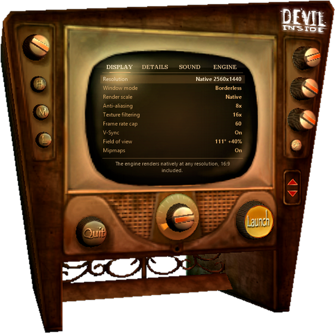

# Devil Inside Plus

A modern launcher for **The Devil Inside** (Gamesquad / Cryo Interactive, 2000) on Windows 10/11,
in the spirit of [Nocturne Plus](https://github.com/skw-1337/nocturne-plus): one window, one **Launch** button,
and the game runs at native resolution on a modern PC.

The launcher *is* the vintage TV of the original `Devil Setup.exe`: its art is read at runtime from your own copy
of the game (nothing from the game is redistributed), the settings are shown on the CRT screen and the knobs
actually turn.

## What it fixes

| Problem on a modern PC | Fix |
|---|---|
| `Devil Setup.exe` crashes on start (`0x0040497D`) | The bundled 2016 DDrawCompat enumerated no 16-bit mode, so the setup's mode list was empty. Replaced by **dgVoodoo 2** (Direct3D 11). The launcher replaces the setup. |
| Game runs ~11× too fast | The engine clock computes the CPU frequency as `MHz × 1,000,000` in 32 bits, which overflows above 4.29 GHz. Patched to use `QueryPerformanceCounter`. |
| "Insert the CD" | CD check loop skipped; the data is already on disk. |
| No CD music | `WINMM.dll` import redirected to the bundled `WinMX.dll` (CD audio emulator): music plays from `Music\Track02-17.ogg`. |
| Image cropped / zoomed in 16:9 | **Hor+ field of view**: same vertical view as 4:3, wider horizontal view (76° → 92° in 16:9, optional extra up to +40 %). |
| Alt+Tab ends the game (`DDERR_SURFACELOST`, `cannot acquire keyboard`) | Surfaces are restored and input is re-acquired instead of a fatal error. |

Every executable patch is byte-checked before writing, reversible from the launcher, and the original
`Devil.exe` is kept in `_DevilInsidePlus\originaux\`.

## Graphics

- Native rendering at any resolution (2560x1440, 3840x2160, 21:9…): the 2000 engine renders natively, no upscaling.
- Up to 8x MSAA, 16x anisotropic filtering, optional 2x/3x supersampling, generated mipmaps (dgVoodoo 2).
- Frame rate cap (60 by default) and V-Sync.
- Engine details (lighting, shadows, textures, mirrors…) written to `Config.ini`.
- Presets on the TV's **H / M / L** buttons: high, medium, original 1024x768 4:3.

## Install

1. Install the game (your own copy).
2. Build or download `DevilInsidePlus.exe` and put it in the game folder, next to `Devil.exe`.
3. Run it (**never as administrator**) and press **Launch**.

dgVoodoo 2.87.5 is downloaded on first launch from the author's official release and checked against a pinned SHA-256.
Game files are **not** included.

## Controls

| On the TV | Does |
|---|---|
| Screen | Click a line: next value · right-click: previous · mouse wheel |
| Big centre knob / page titles | Change page (DISPLAY, DETAILS, SOUND, ENGINE) |
| Left knob, three right knobs | Voices, master, effects, music volume (turn them, scroll, or click left/right side) |
| H / M / L | Quality presets |
| On/Off | Fullscreen or borderless window |
| Launch / Quit | Start the game / close the launcher |
| Keyboard | Arrows, Tab (page), Enter (launch), Esc (quit) |

Drag the wood to move the TV. `DevilInsidePlus.exe /jouer` starts the game directly.

## Known issues

- Only **one** `Devil.exe` may run at a time: a second instance crashes at `0x0067B2FA`. The launcher refuses to
  start a second one; the old desktop shortcut to `Devil.exe` does not check.
- The helicopter camera (key `C`) is broken in the original game.

## Building

`DevilInsidePlus\compiler.bat` builds with the `csc` shipped with Windows (.NET Framework 4, x86). No other tool needed.
Technical notes (causes, offsets, patches): [`DevilInsidePlus/TECHNICAL.md`](DevilInsidePlus/TECHNICAL.md).

## Credits

- **dgVoodoo 2** by Dege — <http://dege.fw.hu> · <https://github.com/dege-diosg/dgVoodoo2> (downloaded, not redistributed)
- `WinMX.dll` (CD audio emulation, `winmm` proxy) shipped with the Abandonware France release of the game
- The Devil Inside © Gamesquad / Cryo Interactive. TV art © its owners, read from your own `Devil Setup.exe`.

## License

Made by skw-1337, released under the [MIT license](LICENSE). The Devil Inside is © its respective owners
(Gamesquad / Cryo Interactive); this launcher contains no game data and reads the TV art from your own
`Devil Setup.exe` at runtime. The screenshot in `docs/` shows that art and is not covered by the MIT license.
